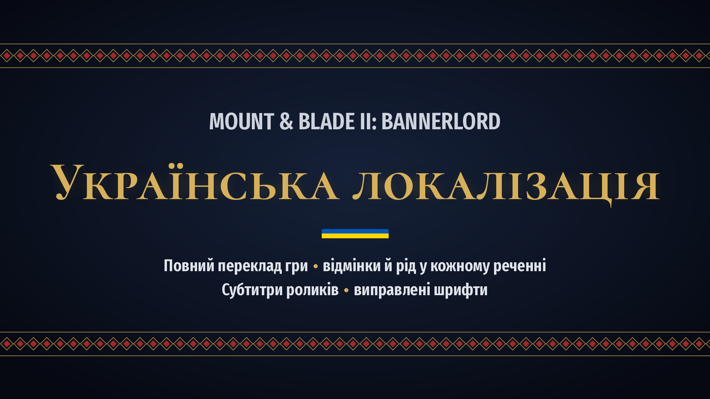

<p align="center"></p>

# Українська локалізація Mount & Blade II: Bannerlord

Повний український переклад гри Mount & Blade II: Bannerlord: кампанія, сюжет, діалоги, енциклопедія, інтерфейс, мережева гра й власні битви.

**Версія гри:** v1.4.8 · **Версія мода:** v1.0.0 · **Автор:** Stepovyk

[English below](#english)

## Що всередині

- **Увесь текст гри українською.** 20 965 рядків, тобто всі тексти базової гри, які гра показує іншими мовами.
- **Відмінки й рід у кожному реченні.** Мод має власний граматичний обробник: «захопили Тисмил», «у Вландії», «з Хузаїтським ханством», «3 імперські рекрути», «вона повернулася». Назви міст, кланів, військ, предметів та імена відмінюються автоматично. Дієслова й прикметники узгоджуються з родом персонажа.
- **Виправлені шрифти.** Літери і, ї, й, є, ґ правильно показуються навіть у декоративних написах, де стандартний шрифт гри їх не має.
- **Українські субтитри** до вступного й фінальних роликів кампанії.
- **Мережева гра.** Окремий модуль для вкладки мультиплеєра в лаунчері.

## Встановлення

1. Завантажте архів `UkrainianLocalization-v1.0.0.zip` з [Releases](../../releases/latest) або з Nexus Mods.
2. Розпакуйте його в теку гри, наприклад `C:\Program Files (x86)\Steam\steamapps\common\Mount & Blade II Bannerlord\`. Теки з архіву мають опинитися в `Modules`.
   Через Vortex: «Install from file» і виберіть архів.
3. У лаунчері відкрийте «Singleplayer» → «Mods» і ввімкніть **«Українська локалізація»**. Для мережевої гри так само ввімкніть **«Українська локалізація (мережева гра)»** на вкладці «Multiplayer».
4. Запустіть гру. Відкрийте **Options → Gameplay → Language** і виберіть **«Українська»**.

> Якщо раніше у вас стояв інший український переклад, вимкніть або видаліть його, щоб мови не конфліктували.

Мод не змінює файлів гри й не впливає на збереження. Їх можна продовжувати з ним і без нього: гра лише попередить про змінений список модів. Субтитри до роликів мод сам додає в теку відео гри окремими файлами `*_uk.srt`.

**Видалення.** Видаліть теки `Modules\UkrainianLocalization` і `Modules\UkrainianLocalizationMP`. Залишки субтитрів (`Modules\SandBox\Videos\**\*_uk.srt`) нешкідливі, їх теж можна видалити.

## Обмеження

- Доповнення **War Sails** поки що не перекладене.
- Озвучення лишається оригінальним. Перекладено текст і субтитри.
- Тексти інших модів перекладають їхні автори.
- Переклад зроблено для версії гри **v1.4.8**. В інших версіях окремі рядки можуть лишатися англійською.

## Підтримати автора

Переклад безкоштовний і таким лишиться. Якщо він вам знадобився, підтримати роботу можна:
- [банкою Monobank](https://send.monobank.ua/jar/8aeC9dGFrn);
- поставивши моду «Endorse» на Nexus Mods.

## Помилки й побажання

Знайшли помилку чи невдалий переклад? Створіть [issue](../../issues) і додайте:
- точний текст із гри (а краще знімок екрана);
- що саме не так;
- як має бути.

## Як долучитися

Переклад зберігається в `translation/<модуль>/<файл>.jsonl`, як і в грі. Кожен рядок файлу — JSON-об’єкт `{"id": "…", "uk": "…"}`:
- `id` — ідентифікатор рядка гри;
- `uk` — український текст із розміткою гри.

Перед правками прочитайте:
- [посібник перекладача](docs/STYLE.md): стиль, розмітка, відмінки, рід, числа;
- [глосарій](docs/GLOSSARY.md).

Перевірка й збирання (потрібні Python 3.9+ і .NET SDK 8):

```bash
python3 tools/check.py --warnings                   # перевірити розмітку перекладу
dotnet build src/UkrainianLocalization -c Release   # зібрати граматичний обробник
python3 tools/build.py --zip                        # зібрати мод у dist/
```

Кожен pull request автоматично проходить перевірку й збирання.

| Тека | Вміст |
|---|---|
| `translation/` | переклад, по файлу на кожен мовний файл гри |
| `src/UkrainianLocalization/` | граматичний обробник (C#): відмінки, рід, числа; словник відмінювання `nouns.tsv` |
| `subtitles/` | субтитри роликів |
| `data/markup.json` | розмітка оригіналу (змінні, теги) для перевірки |
| `tools/` | перевірка (`check.py`) і збирання (`build.py`) |
| `docs/` | посібник і глосарій |

## Ліцензія

Власна робота проєкту (переклад, граматичний обробник, інструменти) поширюється за ліцензією MIT: її можна вільно використовувати й змінювати, зберігаючи згадку про авторство. Mount & Blade II: Bannerlord, її оригінальні тексти й торгові марки належать TaleWorlds Entertainment. Проєкт неофіційний і не пов’язаний із TaleWorlds. Докладніше — у [LICENSE](LICENSE).

---

## English

A complete Ukrainian translation of Mount & Blade II: Bannerlord. It covers the campaign, story, dialogues, encyclopedia, UI, multiplayer and custom battles: 20,965 strings in total.

The mod ships its own Ukrainian grammar processor. It declines names by case (towns, clans, troops, items, people) and agrees verbs and adjectives with a character's gender. It also fixes the decorative font that lacks the letters і, ї and й, and adds Ukrainian subtitles for the campaign videos.

**Game version:** v1.4.8. The War Sails DLC is not translated yet.

**Install:**
1. Extract the release archive into the game folder so that its folders land in `Modules`. With Vortex, use "Install from file".
2. Enable **«Українська локалізація»** in the launcher (Singleplayer → Mods). For multiplayer, also enable the separate module on the Multiplayer tab.
3. Select **«Українська»** in Options → Gameplay → Language.

**Build from source:** `dotnet build src/UkrainianLocalization -c Release && python3 tools/build.py --zip`. This needs .NET SDK 8 and Python 3.9+. The game reference assemblies come from NuGet, so the game does not need to be installed.

Support the author: [Monobank jar](https://send.monobank.ua/jar/8aeC9dGFrn).

The project's own work (translation, grammar processor, tools) is MIT-licensed. Bannerlord and its original texts belong to TaleWorlds Entertainment. This is an unofficial fan project.
